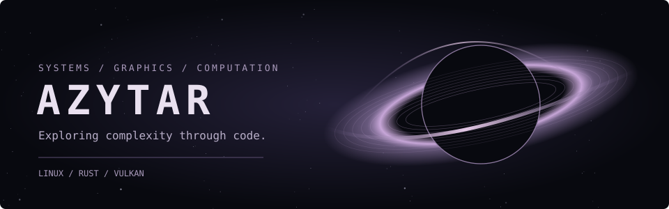

I build software for Linux and explore the systems behind it, from window management to GPU rendering.

### Projects

**[Maverick](https://github.com/Azytar/Maverick)** — Scroll-based tiling window manager for X11.

**[Aura](https://github.com/Azytar/Aura)** — Terminal emulator with a custom text stack and Vulkan renderer.

**[maverickctl](https://github.com/Azytar/maverickctl)** — Independent Unix control and session client.

---

*Understand the system before changing it.*
